# 📐 사진 평가 AI 오케스트레이션 파이프라인 표준 데이터 계약 (Schema Contract)

본 문서는 사진 평가 AI 오케스트레이션 MVP 시스템의 5단계 모듈 간 데이터 교환 규격, 타입 힌트, 필수/선택 필드 및 유효성 검증 규칙을 정의한 팀 표준 데이터 계약 명세서입니다.

---

## 🔄 전체 파이프라인 데이터 흐름도

```mermaid
flowchart LR
    A[Raw Image File] -->|Step 1: prepare_photo| B[PhotoPreparation]
    B -->|Step 2: analyze_with_gemini| C[Raw VLM JSON Response]
    C -->|Step 3: validate_vlm_response| D[PhotoAnalysis]
    D -->|Step 4: clean_analysis_dataframe| E[Cleaned DataFrame]
    E -->|Step 5: aggregate_photo_insights| F[PhotoInsights]
```



---

## 📌 1. 모듈별 입출력 계약 명세 요약표

| 단계 | 모듈명 (함수명) | 입력 (Input) | 출력 (Output) | 핵심 검증 및 제약 사항 |
|---|---|---|---|---|
| **Step 1** | `prepare_photo` | `image_path: str \| Path` | `PhotoPreparation` (`dict[str, Any]`) | JPEG 변환(Q90), 최대 변 3072px 리사이즈, 안전 EXIF 7종 화이트리스트 추출, SHA-256 및 dHash 생성 |
| **Step 2** | `analyze_with_gemini` | `photo: PhotoPreparation`<br>`model: str`<br>`hint: str` | `PhotoAnalysis` (`dict[str, Any]`) | SHA-256 64자리 16진수 검증, 필수 EXIF 키 검증, VLM 프롬프트 주입 격리 및 Mock 통신 |
| **Step 3** | `validate_vlm_response` | `raw_text: str` | `PhotoAnalysis` (`dict[str, Any]`) | Markdown 코드블록 제거, 필수 7개 필드 검증, 5대 점수(0.0~10.0), 6대 태그 보캡(범주당 최대 2개), 초점 5종 상태 검증 |
| **Step 4** | `clean_analysis_dataframe` | `df_raw: pd.DataFrame` | `df_cleaned: pd.DataFrame` | 필수 컬럼(`id`, `final_score`, `captured_at`, `tags`), 점수 0.0~10.0 클리핑, 날짜 `datetime64[ns]` 변환, 결측 점수 행 제거 |
| **Step 5** | `aggregate_photo_insights` | `df_analyses: pd.DataFrame` | `PhotoInsights` (`dict[str, Any]`) | 유효 사진 수 집계, 월별 추이(`YYYY-MM`), 최소 2회 이상 등장 태그 대상 상위/하위 5개 통계 산출 |

---

## 📋 2. 단계별 상세 스키마 및 Python Type 명세 (Step 1 ~ Step 5)

### [Step 1] 사진 전처리: `prepare_photo`

- **함수 시그니처**: `prepare_photo(image_path: str | Path) -> PhotoPreparation`
- **입력**: 이미지 파일 경로 (`str` 또는 `pathlib.Path`)
- **지원 포맷**: `JPEG`, `PNG`, `WEBP`, `MPO` (손상 파일 또는 미지원 포맷은 `ValueError` 발생)
- **출력 스키마 (`PhotoPreparation`)**:

```python
from typing import TypedDict, Any

class SafeExif(TypedDict, total=False):
    """안전 화이트리스트 EXIF 메타데이터 (GPS 등 개인정보 완전 제외)."""
    camera_model: str | None     # 카메라 제조사/모델명 (기본 IFD 0x0110)
    lens_model: str | None       # 렌즈 모델명 (Exif 서브 IFD 0xA434)
    aperture: float | int | None # 조리개 값 (Exif 서브 IFD 0x829D)
    shutter_speed: float | int | None # 셔터 스피드 (Exif 서브 IFD 0x829A)
    iso: int | float | None      # 감도 (Exif 서브 IFD 0x8827)
    focal_length: float | int | None # 초점거리 (Exif 서브 IFD 0x920A)
    captured_at: str | None      # 촬영 일시 (Exif 서브 IFD 0x9003)

class PhotoPreparation(TypedDict):
    """prepare_photo 함수의 표준 반환 타입."""
    path: str              # 원본 이미지 절대/상대 경로 문자열
    sha256: str            # 원본 파일 기준 64자리 16진수 SHA-256 해시
    safe_exif: SafeExif    # 정규화된 안전 EXIF 딕셔너리
    upload_bytes: bytes    # VLM 전송용 최적화 JPEG 바이트 스트림 (Max 3072px, Q90)
    dhash: str             # 16자리 유사도 비교용 Difference Hash (Hex string)
    width: int             # 리사이즈 완료된 이미지 너비 (px)
    height: int            # 리사이즈 완료된 이미지 높이 (px)
```

- **출력 JSON 데이터 예시**:
```json
{
  "path": "data/photos/sample_01.jpg",
  "sha256": "4a7d1ed414474e4033ac29ccb8653d9b0024f2b963bfbf4a340b9b32e6ff7dfa",
  "safe_exif": {
    "camera_model": "SONY ILCE-7M4",
    "lens_model": "FE 24-70mm F2.8 GM II",
    "aperture": 2.8,
    "shutter_speed": 0.004,
    "iso": 100,
    "focal_length": 50.0,
    "captured_at": "2026:10:15 14:30:00"
  },
  "upload_bytes": "<bytes omitted>",
  "dhash": "8f8e0c0c0c8e8f00",
  "width": 3072,
  "height": 2048
}
```

---

### [Step 2 & Step 3] VLM 분석 및 응답 검증: `analyze_with_gemini`, `validate_vlm_response`

- **Step 2 함수 시그니처**: `analyze_with_gemini(photo: dict[str, Any], model: str, hint: str) -> PhotoAnalysis`
- **Step 3 함수 시그니처**: `validate_vlm_response(raw_text: str) -> PhotoAnalysis`
- **태그 통제 어휘집 (Fixed Vocabulary)**:
  - **피사체 장르**: `"자연풍경"`, `"건축도시"`, `"인물동물"`, `"사물정물"`, `"거리스냅"`
  - **빛의 조건**: `"안정된 순광"`, `"골든아워"`, `"흐린날 확산광"`, `"극단적 역광"`, `"저조도 야경"`
  - **피사체 동세**: `"완전 정지"`, `"완만한 흐름"`, `"예측불가 빠른동세"`, `"찰나의 순간"`
  - **카메라 앵글**: `"아이레벨"`, `"로우 앵글"`, `"하이앵글(탑뷰)"`, `"피사체 눈높이 일치"`, `"틸트사선"`
  - **공간 구성**: `"단일피사체 집중"`, `"다층 레이어"`, `"프레임인프레임"`, `"대칭패턴"`, `"여백의미"`
  - **색채 조화**: `"자연스런 뉴트럴"`, `"뚜렷한 보색대비"`, `"차분한 모노톤"`, `"다채로운 색정돈"`, `"절제된 톤다운"`
- **초점 상태 허용치**: `"완벽 칼초점"`, `"미세 앞핀"`, `"미세 뒤핀"`, `"초점 이탈"`, `"판별 불가"`
- **출력 스키마 (`PhotoAnalysis`)**:

```python
from typing import TypedDict, Literal

TagSubjectGenre = Literal["자연풍경", "건축도시", "인물동물", "사물정물", "거리스냅"]
TagLighting = Literal["안정된 순광", "골든아워", "흐린날 확산광", "극단적 역광", "저조도 야경"]
TagMotion = Literal["완전 정지", "완만한 흐름", "예측불가 빠른동세", "찰나의 순간"]
TagAngle = Literal["아이레벨", "로우 앵글", "하이앵글(탑뷰)", "피사체 눈높이 일치", "틸트사선"]
TagComposition = Literal["단일피사체 집중", "다층 레이어", "프레임인프레임", "대칭패턴", "여백의미"]
TagColorHarmony = Literal["자연스런 뉴트럴", "뚜렷한 보색대비", "차분한 모노톤", "다채로운 색정돈", "절제된 톤다운"]

class AestheticTags(TypedDict):
    """6대 범주별 태그 (각 범주당 최대 2개 허용, 빈 리스트 허용)."""
    피사체_장르: list[TagSubjectGenre]
    빛의_조건: list[TagLighting]
    피사체_동세: list[TagMotion]
    카메라_앵글: list[TagAngle]
    공간_구성: list[TagComposition]
    색채_조화: list[TagColorHarmony]

FocusStatus = Literal["완벽 칼초점", "미세 앞핀", "미세 뒤핀", "초점 이탈", "판별 불가"]

class PhotoAnalysis(TypedDict):
    """Step 2 및 Step 3의 공통 검증 완료 출력 스키마."""
    final_score: float             # 0.0 ~ 10.0 (종합 평가 점수)
    composition_score: float       # 0.0 ~ 10.0 (구도 점수)
    lighting_score: float          # 0.0 ~ 10.0 (조명/빛 점수)
    color_score: float             # 0.0 ~ 10.0 (색채 조화 점수)
    technique_score: float         # 0.0 ~ 10.0 (기술적 완성도 점수)
    aesthetic_tags: AestheticTags  # 6대 범주 태그 딕셔너리
    focus_status: FocusStatus      # 초점 판별 상태
```

- **출력 JSON 데이터 예시**:
```json
{
  "final_score": 8.5,
  "composition_score": 9.0,
  "lighting_score": 8.0,
  "color_score": 8.5,
  "technique_score": 8.5,
  "aesthetic_tags": {
    "피사체 장르": ["자연풍경"],
    "빛의 조건": ["골든아워"],
    "피사체 동세": ["완전 정지"],
    "카메라 앵글": ["아이레벨"],
    "공간 구성": ["여백의미", "단일피사체 집중"],
    "색채 조화": ["자연스런 뉴트럴"]
  },
  "focus_status": "완벽 칼초점"
}
```

---

### [Step 4] 데이터 정제: `clean_analysis_dataframe`

- **함수 시그니처**: `clean_analysis_dataframe(df_raw: pd.DataFrame) -> pd.DataFrame`
- **입력**: 파이프라인 분석 결과들이 누적된 `pd.DataFrame`
- **정제 및 클리핑 규칙**:
  1. **필수 컬럼 확인**: `id`, `final_score`, `captured_at`, `tags` 중 하나라도 누락되면 `ValueError` 발생.
  2. **`final_score`**: 유한한 숫자만 `float64`로 변환. $0.0 \sim 10.0$ 범위를 벗어나면 클리핑(`min(10.0, max(0.0, score))`). 숫자로 변환 불가능한 행은 완전히 제거(Drop).
  3. **`captured_at`**: `YYYY-MM-DD` 또는 ISO-8601 형식을 `datetime64[ns]`로 변환. 타임존 정보는 제거하여 로컬 촬영 일시 보존. 변환 실패 시 `NaT` 처리.
  4. **행 보존성**: 원본 인덱스 구조, 행 순서, 추가적인 메타데이터 컬럼을 불변 복사(`deep=True`)로 보존.
- **DataFrame 컬럼 계약 명세**:

| 컬럼명 | 원본 입력 허용 타입 | 정제 후 출력 타입 | Null/NaN 허용 | 설명 |
|---|---|---|---|---|
| `id` | `object` (`str`, `int`) | `object` | ❌ 불가 | 사진 레코드 고유 ID |
| `final_score` | `float`, `int`, `str`, `Decimal` | `float64` | ❌ **제거됨** | 0.0 ~ 10.0 클리핑된 실수 |
| `captured_at` | `str`, `datetime`, `date`, `Timestamp` | `datetime64[ns]` | ⭕ **허용 (NaT)** | 표준 타임스탬프 (시간대 제외) |
| `tags` | `list[str]` | `object` (`list[str]`) | ⭕ 허용 | 추출된 태그 리스트 |

---

### [Step 5] 통계 및 시계열 분석: `aggregate_photo_insights`

- **함수 시그니처**: `aggregate_photo_insights(df_analyses: pd.DataFrame) -> PhotoInsights`
- **입력**: Step 4를 거친 `pd.DataFrame` (필수 열: `id`, `final_score`, `captured_at`, `tags`)
- **집계 규칙**:
  1. DataFrame이 비어 있거나 None인 경우 기본 빈 스키마(`total_photos: 0`, 빈 딕셔너리/리스트) 반환.
  2. `captured_at`이 유효한 행만 연월(`YYYY-MM`) 단위로 그룹화하여 건수 및 평균 점수(소수 둘째 자리) 계산.
  3. `tags`를 `explode`하여 정규화한 후, **최소 2회 이상 등장한 태그(`count >= 2`)만 필터링**.
  4. 신뢰성 태그 중 상위 5개(평균점수 내림차순)와 하위 5개(평균점수 오름차순) 도출 (동점 시 등장 건수 내림차순).
- **출력 스키마 (`PhotoInsights`)**:

```python
from typing import TypedDict

class MonthlyMetric(TypedDict):
    count: int          # 해당 월의 분석 사진 건수
    avg_score: float    # 해당 월의 평균 종합 점수 (소수점 둘째 자리 반올림)

class TagMetric(TypedDict):
    tag: str            # 태그명 (공백 정규화 완료)
    avg_score: float    # 태그별 평균 점수 (소수점 둘째 자리 반올림)
    count: int          # 출현 빈도수 (신뢰성 필터: count >= 2)

class PhotoInsights(TypedDict):
    total_photos: int                           # 유효 사진 총 건수
    monthly_trend: dict[str, MonthlyMetric]     # 월별 시계열 통계 (Key: "YYYY-MM")
    top_tags: list[TagMetric]                   # 우수 태그 Top 5
    bottom_tags: list[TagMetric]                # 취약 태그 Bottom 5
```

- **출력 JSON 데이터 예시**:
```json
{
  "total_photos": 42,
  "monthly_trend": {
    "2026-09": {
      "count": 18,
      "avg_score": 7.82
    },
    "2026-10": {
      "count": 24,
      "avg_score": 8.35
    }
  },
  "top_tags": [
    {
      "tag": "골든아워",
      "avg_score": 9.15,
      "count": 6
    },
    {
      "tag": "완벽 칼초점",
      "avg_score": 8.90,
      "count": 14
    }
  ],
  "bottom_tags": [
    {
      "tag": "초점 이탈",
      "avg_score": 4.50,
      "count": 3
    },
    {
      "tag": "극단적 역광",
      "avg_score": 5.20,
      "count": 2
    }
  ]
}
```

---

## 🔒 3. 데이터 보안 및 파이프라인 거버넌스 규칙

1. **개인정보/프라이버시 보호 (Privacy by Design)**:
   - `prepare_photo` 모듈은 GPS 좌표, 기기 일련번호 등 사용자 식별성 메타데이터를 원천 차단하고 오직 7개 화이트리스트 EXIF만 추출합니다.
2. **프롬프트 인젝션 및 무결성 격리**:
   - `analyze_with_gemini` 호출 시 사용자 전달 문자열(`hint`)은 JSON 페이로드 내 순수 데이터 필드로만 주입되며, 시스템 지시사항을 무력화할 수 없도록 격리합니다.
3. **스키마 계약 엄격성 (Contract Enforcement)**:
   - 다운스트림 모듈(`photo_analytics`)은 Step 4에서 정제된 계약(`clean_analysis_dataframe`)을 신뢰하되, 비정상 데이터 유입 시 크래시 대신 `empty_contract`를 반환하는 방어적 설계를 유지합니다.
