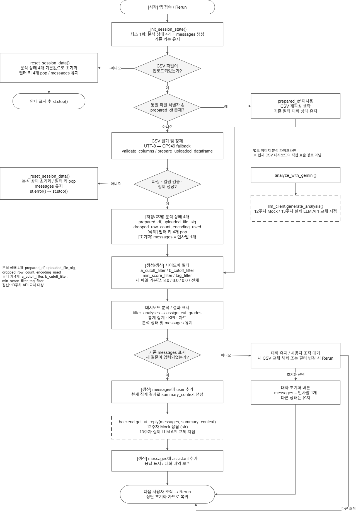

# 12주차 session_state 데이터 흐름

## 1. session_state 키 정리

기준: 2026-11-24 확인한 [app.py](https://github.com/ai-ocst-team/ai-studio-week09/blob/main/app.py). 명시적으로 관리하는 상태 키는 총 9개(직접 관리 5개, 위젯 키 4개)이다.

| 키 이름 | 자료형 | 초기화 위치 | 읽는 곳 | 쓰는 곳 |
|---|---|---|---|---|
| `prepared_df` | `pd.DataFrame` 또는 `None` | `_init_session_state()` L55–57: `None` | `main()` L93 캐시 판정, L128 정제 데이터 재사용 | L118 정제 완료 데이터 저장, `_reset_session_data()` L45 |
| `uploaded_file_sig` | `tuple[str 또는 None, str, int]` 또는 `None` | `_init_session_state()` L58–59: `None` | `main()` L92–93 파일 식별자 비교 | L119 성공한 파일의 식별자 저장, `_reset_session_data()` L46 |
| `dropped_row_count` | `int` | `_init_session_state()` L60–61: `0` | `main()` L134–137 제외 행 경고 | L120 `count_dropped_rows()` 반환값 저장, `_reset_session_data()` L47 |
| `encoding_used` | `str` | `_init_session_state()` L62–63: `"utf-8"` | `main()` L132–133 CP949 경고 | L121 인코딩 저장, `_reset_session_data()` L48 |
| `a_cutoff_filter` | `float` | `main()` L142–149 A컷 슬라이더 최초 렌더링: `8.0` | 슬라이더 반환값 → `raw_a_cutoff` → 기준 검증 및 L195 등급 판정 | 슬라이더 조작 시 Streamlit이 갱신; `pop()` L124 / L51 |
| `b_cutoff_filter` | `float` | `main()` L150–157 B컷 슬라이더 최초 렌더링: `6.0` | 슬라이더 반환값 → `raw_b_cutoff` → 기준 검증 및 L195 등급 판정 | 슬라이더 조작 시 Streamlit이 갱신; `pop()` L125 / L52 |
| `min_score_filter` | `float` | `main()` L174–181 최소 점수 슬라이더 최초 렌더링: `0.0` | 슬라이더 반환값 `min_score` → L194 `filter_analyses()` | 슬라이더 조작 시 Streamlit이 갱신; `pop()` L122 / L49 |
| `tag_filter` | `str` 또는 `None` | `main()` L182–188 `pills` 최초 렌더링: `"전체"` | L168–172 유효 태그 검사; 반환값 `picked_tag` → `selected_tag` → L194 필터링 및 태그 설명 | `pills` 선택/해제 시 갱신; L173 선택지가 유효하지 않으면 `ALL_TAGS` 대입; `pop()` L123 / L50 |
| `messages` | `list[dict[str, str]]` | `_init_session_state()` L64–67: assistant 인사 1개 | `main()` L255–257 대화 렌더링, L270–273 `get_ai_reply()` 입력 | L260 user 추가, L274 assistant 추가, `_reset_chat_messages()` L69–73 |

## 2. 데이터 흐름 구조도

