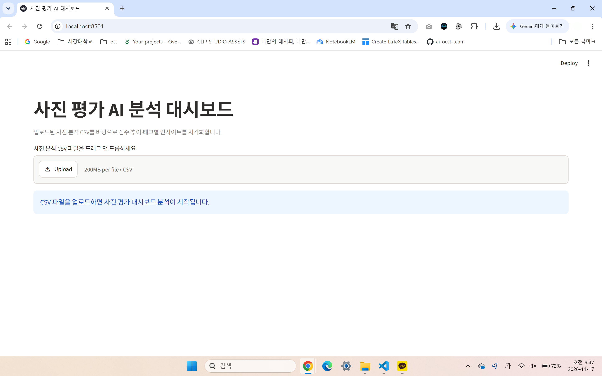
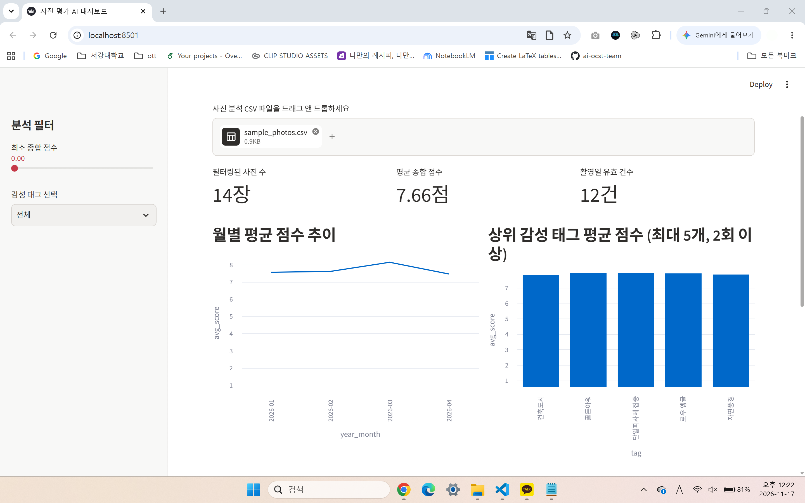
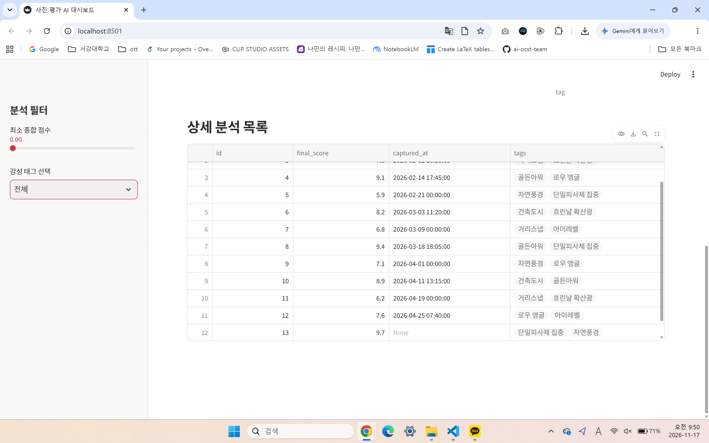
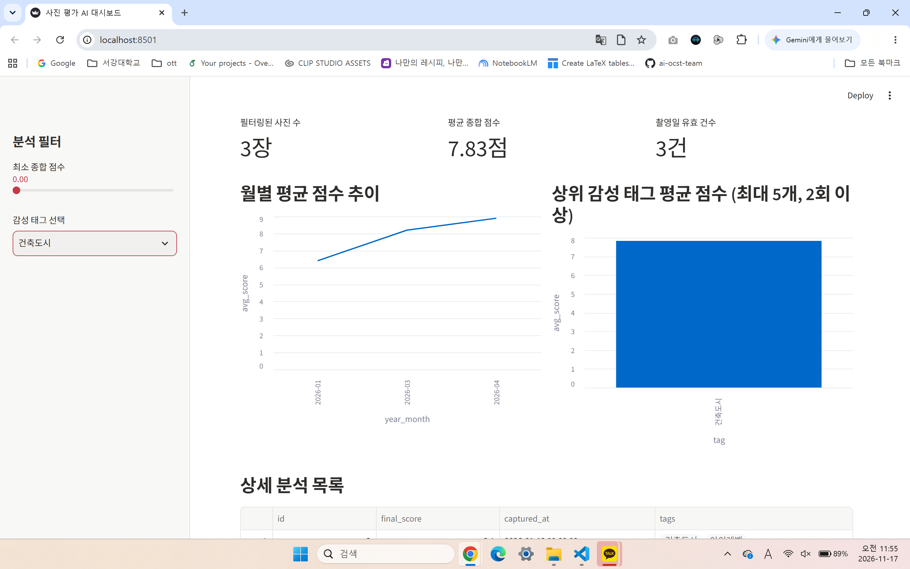
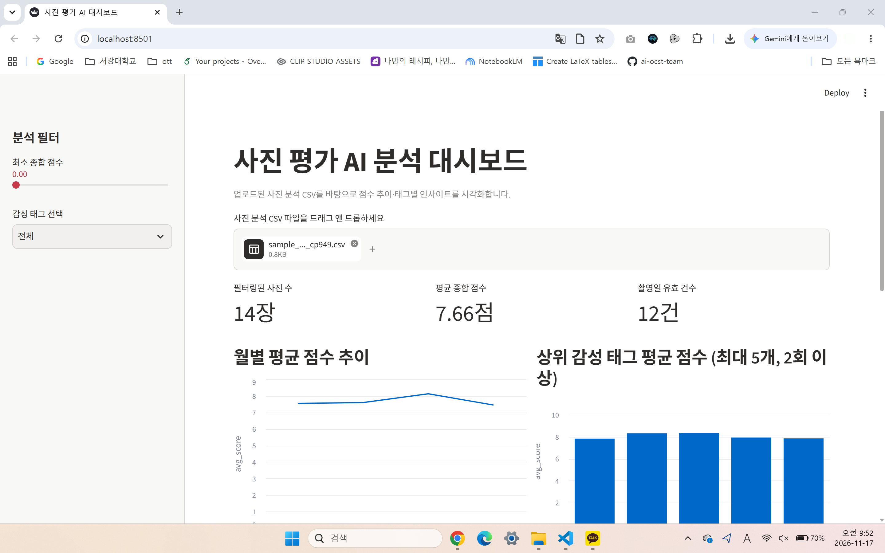
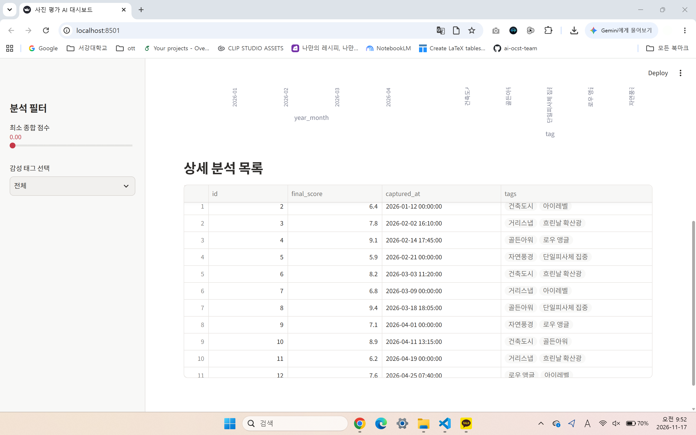
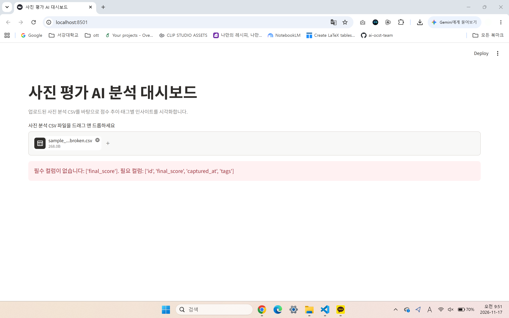

# 11주차 Streamlit 대시보드 수동 검증 보고서

- **담당자:** 신비
- **대상 저장소:** https://github.com/ai-ocst-team/ai-studio-week09
- **검증 대상 브랜치:** `main` 
- **검증 커밋:** `7ec2135`
- **검증 일시 / 환경:** `2026-11-17` / Windows, Python `3.13.15`, Streamlit `1.67.0`

## 1. 검증 목적·범위

CSV 업로드부터 백엔드 정제·필터링·집계, Streamlit KPI·차트·표 출력까지 이어지는 동작을 실제 브라우저에서 검증한다. **초기 화면** 및 과제에서 지정한 **3종 CSV(UTF-8 정상 / CP949 정상 / 필수 컬럼 누락)**를 대상으로 한다.

**검증에 사용한 파일**

| 용도 | 파일 경로 | 예상 속성 |
|---|---|---|
| 정상 입력 | `sample_data/sample_photos.csv` | UTF-8, 필수 컬럼 4개 |
| 인코딩 폴백 | `sample_data/sample_photos_cp949.csv` | CP949, 정상 파일과 동일한 데이터 |
| 컬럼 누락 | `sample_data/sample_photos_broken.csv` | `final_score` 의도적 누락 |
| 테스트 실행 기록 | `tests/pytest_week11_log.txt` | 실제 전체 pytest 출력 |

### 검증 시 기록할 공통 수치

동일한 필터(최소 점수 `0.0`, 태그 `전체`)를 설정한 뒤 정상 CSV와 CP949 CSV의 결과를 비교한다.

| 비교 항목 | 정상 UTF-8 | CP949 | 일치 여부 |
|---|---|---|---|
| 분석 사진 수 | 14장 | 14장 | 일치 |
| 평균 종합 점수 | 7.66점 | 7.66점 | 일치 |
| 촬영일 유효 건수 | 12건 | 12건 | 일치 |
| 월별 차트 데이터 | 2026년 1~4월, 총 4개월 | 2026년 1~4월, 총 4개월 | 일치 |
| 태그 차트 및 한글 표시 | 한글 태그 8종 | 한글 태그 8종 | 데이터 일치 |

정상 UTF-8 CSV와 CP949 CSV는 동일한 14개의 사진 분석 데이터를 포함하며, 인코딩 방식에 따른 데이터 값의 차이는 없다. 전체 평균 종합 점수는 약 7.66점이며, 촬영일이 누락된 2건을 제외한 12건이 월별 집계 대상이다. 또한 8종의 태그가 모두 2회 이상 등장하므로 태그별 평균 점수 차트의 집계 조건을 충족한다.

## 2. 초기 화면 — 업로드 이전

| 구분 | 내용 |
|---|---|
| 사전 조건 | Streamlit 앱 실행 후 새 브라우저 세션에서 업로드 파일을 선택하지 않음 |
| 수행 절차 | ① `python -m streamlit run app.py` 실행 → ② `http://localhost:8501` 접속 → ③ 업로드 전 화면 관찰 |
| 기대 결과 | 업로드 위젯과 `st.info` 안내문이 표시됨. 업로드 전 `st.stop()`으로 분석 KPI·차트·표 출력은 진행되지 않음 |
| 실제 관찰 | CSV 업로드 위젯과 업로드 안내 메시지가 표시되었으며, 파일을 선택하지 않은 상태에서는 KPI·차트·데이터 표가 출력되지 않았다. |
| 판정 | ☒ 통과 ☐ 실패 ☐ 미실행 |
| 이미지 증거 |  |

- [x] 업로드 위젯 표시
- [x] 업로드 전 안내 문구 표시
- [x] 미업로드 상태에서 KPI·차트·데이터 표 미출력

## 3. 시나리오 ① — 정상 UTF-8 CSV

| 구분 | 내용 |
|---|---|
| 사전 조건 | `sample_data/sample_photos.csv` 존재; 사이드바 점수 `0.0`, 태그 `전체` |
| 수행 절차 | ① 파일 업로드 → ② 세 KPI 확인 → ③ 월별 평균 점수 및 태그 평균 점수 차트 확인 → ④ 데이터 표 확인 → ⑤ 최소 점수 및 태그 필터 변경 후 출력 즉시 갱신 확인 |
| 기대 결과 | 오류 없이 파싱되고 사진 수·평균 점수·유효 촬영일 건수, 월별/태그 차트, 필터링 표가 표시됨. 사이드바 조작 후 표시 결과가 조건에 맞게 바뀌며 업로드한 파일 선택 상태가 유지됨 |
| 실제 관찰 |정상 CSV 업로드 후 필터링된 사진 수 14장, 평균 종합 점수 7.66점, 촬영일 유효 건수 12건이 표시되었다. 태그 평균 점수 차트와 상세 분석 목록이 출력되었으며, 태그를 '건축도시'로 변경하자 사진 수가 3장, 평균 점수가 7.83점으로 갱신되었다.|
| 판정 | ☒ 통과 ☐ 실패 ☐ 미실행 |
| 기본 화면 이미지 |  |
| 필터 반영 이미지(추가 권장) |  |

- [x] KPI 세 항목 모두 표시
- [x] 최소 3개월의 월별 데이터가 차트에 나타남 (샘플 데이터 설계 기준)
- [x] 2회 이상 등장한 태그의 평균 점수 차트 표시
- [x] 데이터 표의 컬럼/행 확인
- [x] 점수 필터를 올리면 모든 표시 행의 `final_score`가 하한 이상임
- [x] 특정 태그를 선택하면 표시 행의 `tags`에 해당 태그가 포함됨
- [x] 필터 변경에도 화면 오류·업로드 해제 없음

## 4. 시나리오 ② — CP949 인코딩 CSV

| 구분 | 내용 |
|---|---|
| 사전 조건 | `sample_data/sample_photos_cp949.csv` 존재; 정상 CSV와 공정하게 비교하도록 필터를 `0.0` / `전체`로 설정 |
| 수행 절차 | ① CP949 파일로 교체해 업로드 → ② 한글 태그와 표가 정상인지 확인 → ③ 세 KPI와 두 차트 확인 → ④ 시나리오 ①과 주요 결과 비교 |
| 기대 결과 | UTF-8 디코드 실패 후 `seek(0)` 및 CP949 재시도로 정상 로드됨. 한글이 깨지지 않고 정상 CSV와 동일한 데이터 집계 결과가 나타남 |
| 실제 관찰 | CP949 CSV 업로드 시 디코딩 오류 없이 정상 처리되었으며, 사진 수 14장, 평균 종합 점수 7.66점, 촬영일 유효 건수 12건으로 UTF-8 CSV와 동일한 KPI가 출력되었다. 월별 평균 점수 차트와 태그 평균 점수 차트가 표시되었고, 상세 분석 목록의 한글 태그에서도 문자 깨짐이 발생하지 않았다. |
| 판정 | ☒ 통과 ☐ 실패 ☐ 미실행 |
| 이미지 증거 |  |

- [x] UnicodeDecodeError나 예외 스택 트레이스 미노출
- [x] 한글 태그 텍스트 정상 출력
- [x] KPI 및 차트 정상 출력
- [x] 동일 필터 조건에서 UTF-8 결과와 KPI·차트 데이터 일치

> 한글이 표시된다는 사실만으로 CP949 폴백 내부 구현을 직접 증명할 수는 없다. 폴백의 `seek(0)` 경로는 `tests/test_csv_scenarios.py`와 `app.py` 코드도 함께 확인한다.

## 5. 시나리오 ③ — 필수 컬럼 누락 CSV

| 구분 | 내용 |
|---|---|
| 사전 조건 | `sample_data/sample_photos_broken.csv` 존재 (`final_score` 컬럼 누락) |
| 수행 절차 | ① 깨진 CSV 업로드 → ② 오류 안내 문구 확인 → ③ KPI·차트·표와 스택 트레이스가 나타나는지 확인 |
| 기대 결과 | 앱이 비정상 종료하지 않고 `final_score` 필수 컬럼 누락을 사용자가 이해할 수 있는 `st.error`로 안내함. 뒤의 분석 화면은 진행되지 않음 (`st.stop()`) |
| 실제 관찰 | final_score 컬럼이 누락된 CSV를 업로드하자 필수 컬럼 누락을 알리는 오류 메시지가 표시되었다. 오류 메시지 하단에 KPI·차트·데이터 표가 출력되지 않았으며, Python 예외 스택 트레이스도 노출되지 않았다. / 화면 표시 문구: 필수 컬럼이 없습니다: ['final_score'] 필요 컬럼: ['id', 'final_score', 'captured_at', 'tags'] |
| 판정 | ☒ 통과 ☐ 실패 ☐ 미실행 |
| 이미지 증거 |  |

- [x] `final_score` 누락을 명확히 알리는 오류 문구 표시
- [x] Python 예외 스택 트레이스 미노출
- [x] 잘못된 CSV에서 KPI·차트·표 미출력
- [x] 다른 정상 파일로 다시 업로드하면 복구 가능 (추가 검증)

## 6. 전체 pytest 실행 기록

- **실행 위치:** 저장소 루트
- **실행 명령:** `python -m pytest -v -o addopts=""`
- **로그 위치:** [pytest_week11_log.txt](../tests/pytest_week11_log.txt)
- **테스트 수행 일자:** 2026-11-17
- **검증 기준 커밋:** `7ec2135`
- **실제 요약:** 192 passed, 12 warnings in 5.56s
- **프로세스 종료 코드:** [별도 확인 후 기입]
- **판정:** ☒ 전체 통과 ☐ 실패 있음 ☐ 미실행

> 기본 명령어 python `-m pytest -v` 실행 시 192개 테스트가 모두 선택 제외되어 실제 검증이 수행되지 않았다. `-o addopts=""` 옵션으로 추가 설정을 비운 후 재실행하여 192개 테스트가 모두 통과하는 것을 확인하였다.

## 7. 결함·재검증 및 최종 판정

| 번호 | 재현 단계·관찰된 오류 | 담당 Task에 전달한 내용/링크 | 수정 후 재검증 |
|---|---|---|---|
| 1 | `발견없음` | `해당없음` | `해당없음` |

**최종 판정:** ☒ 전체 통과 ☐ 조건부 통과 ☐ 실패

- **최종 확인 일시:** `2026-11-17`
- **최종 확인자:** `신비`